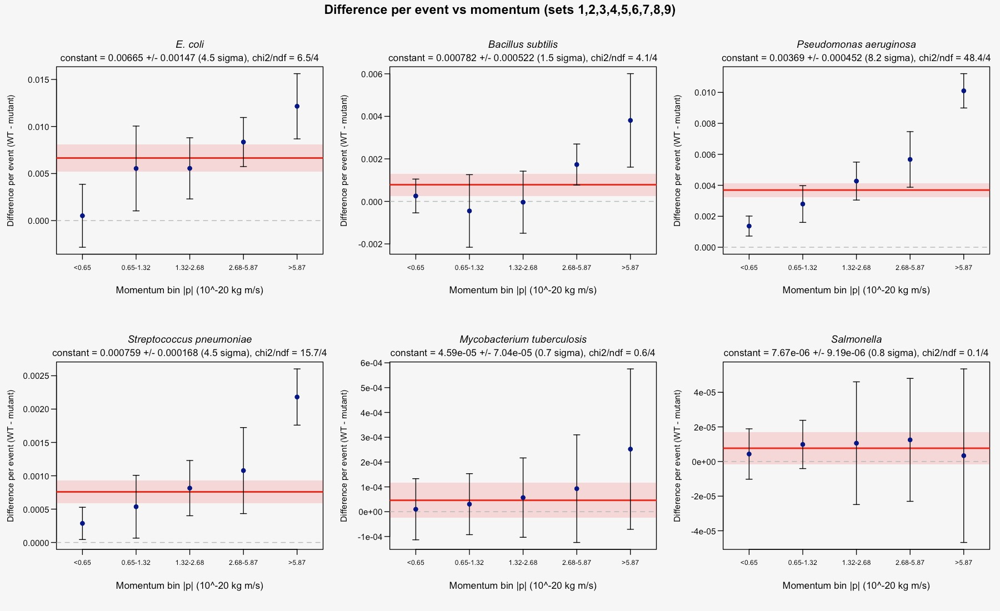
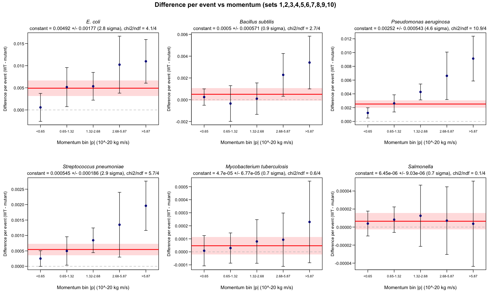

PRA2003 – Bacterial tracking analysis (Emma Schwarz)

It answers the three questions from the assignment:

Question 1: What are the average counts of each strain, and their statistical uncertainties?

Question 2: Is there an asymmetry between the normal (wild-type) strain and its variant? Quantify it.

Question 3: Is there an asymmetry as a function of momentum? Quantify it.

All 10 data sets were used (output-Set1.txt to output-Set10.txt), each set including about 500 000 events. Each event is one simulated experiment and lists every bacterium seen in it, as px py pz code.

Events with 0 bacteria were left excluded, since nothing was observed, leaving 4,617,993 events in total, about 462,000 per set.

The files contain 38 different codes. Only the 12 in the table below are the strains we're studying. All other codes are background and are left out of every result here.

                                  METHODS 
The subsampling method was used, treating each 10 data sets as as one independent subsample.

PART1: each data file is read in chunksso a file never has to fit in memory all at once. It works out an average number per event in that file for every code. The results for all 10 files are saved to sub_sample_results.csv.

PART2: the 10 subsamples are combined. The final average consists of the weighted mean of the 10 subsample averages. The uncertainty is the standard deviation of the 10 sub-sample averages. The weighted mean and the plain mean of the 10 values agree to the 4th decimal place, so the weighting doesn't change anything.

ASYMMETY SCRIPT: each wild type is compared to it's variant (set by set) --> Question 2

Signifance criterion --> 3σ

A difference that was smaller than 3 standard deviations --> consistent with 0 A difference of 3σ or more --> counted as real, statistically significant asymmetry

                Question 1 – Average count per event

        Code	  Strain	                     Average per event ± SD
        211	    E. coli WT	                         19.949 ± 0.033
        −211	E. coli mutant	                     19.917 ± 0.032
        321	    B.subtilis WT	                     2.5091 ± 0.0048
        −321	B. subtilis mutant	                 2.5035 ± 0.0055
        2212	P. aeruginosa WT	                 1.2080 ± 0.0019
        −2212	P. aeruginosa, antibiotic-resistant	 1.1842 ± 0.0024
        3122	S. pneumoniae	                     0.2766 ± 0.0011
        −3122	Capsule-deficient S. pneumoniae      0.2717 ± 0.0010
        3312	M. tuberculosis	                     0.03944 ± 0.00028
        −3312	Drug-resistant M. tuberculosis	     0.03900 ± 0.00040
        3334	Salmonella enterica	                 0.00119 ± 0.00004
        −3334	Salmonella mutant	                 0.00115 ± 0.00005
Together these 12 strains make up about 48 bacteria per event. E. coli is by far the most common, at about 20 per event for each of WT and mutant. Salmonella is the rarest, at roughly one cell per 1,000 events.

Question 2 – Is there an asymmetry between wild type and variant?

 How were they compared:
    The differnces was taken for each pair 

--> Δ = (WT average) − (variant average) 

 seperately (in each of the 10 sets). The mean of the 10 differences as the results as well as their standard deviation as the uncertainty 
  
We also give the normalised asymmetry

    A = (WT − variant) / (WT + variant)

  worked out the same way, so pairs with very different abundances can be compared.
  
  Why set by set? 
      
      The numbers show that WT and variant rise and fall together from one set to the next. In set 1, for example, E. coli WT and mutant are both high (20.010 and 19.982). In set 9 they are both low (19.912 and 19.889). 
     
      Comparing within each set --> cancels out that shared fluctuation + only the real WT–variant difference is left.
If you instead subtract the two final averages and combine their uncertainties in quadrature, that shared fluctuation gets counted as noise. For E. coli that approach gives only 0.7σ, even though the WT is ahead of the mutant in all 10 sets.

                                                          RESULTS

                                                          CONCLUSION
There is an asymmetry but only in 3 of the 6 pairs and in each one the wild type is the more common one.

- P. aeruginosa: clear asymmetry (10.1σ) --> wild typs = about 2% more common than antibiotic resistant one (ahead in all 10 sets) 
    --> Strongest result

- S. pneumoniae: clear asymmetry (8.5σ) --> normal strain = about 1.8% more common than capsule-deficient variant (in all 10 sets)

- E. coli: small but real asymmetry (7.2σ) --> Tiny effect : WT 0.16% more common: it is still far above 3σ and holds in every set. E. coli is so abundant that    even a very small difference can be measured

- B. subtilis: no significant asymmetry (1.7σ) --> The WT is slightly ahead in 9 of the 10 sets : hints at something, but at 1.7σ it is well below our 3σ criterion -->  with the data it is consistent with no asymmetry

- M. tuberculosis and Salmonella: no significant asymmetry (0.9σ and 0.5σ)-->  These strains are rare, so their uncertainties are large compared with any difference. We can't rule out a small asymmetry: with 3σ we could only have detected one bigger than about 2% for M. tuberculosis and about 9% for Salmonella.

  
The three significant results clear 3σ even with these larger errors --> the conclusion that they are real asymmetries holds.

Question 3: 
                                                                METHODS

1. Momentum of each bacterium of one of the 12 strains, in all 10 files: `|p| = sqr(px^2 + py^2 + pz^2)` (in 10^-20 kg m/s).
2. Each bacterium is assigned to one of the **5 momentum bins. The bin edges are the 20/40/60/80% points (quantiles) of the momentum in Set 1, so each bin contains ~20% of the bacteria and has similar statistics: < 0.65, 0.65 – 1.32, 1.32 – 2.68, 2.68 – 5.87, > 5.87
   Same limits for each file. The first and last bins are open-ended, so all bacteria are counted.
3. For each file, strain pair and bin, the WT and mutant counts are turned into averages per event (exactly as in sections 4 and 5) anD        subtracted
   within that file: `Dᵢ = count_WTᵢ / nEventsᵢ − count_mutantᵢ / nEventsᵢ`
   This is the same quantity as question 2 (a difference per event, not a ratio), so the five bins of a pair add up to its overall           difference.
4. For each pair, and each bin, the result of the sub-sampling method is: the point is the mean of the per-file values of `Dᵢ`, the            uncertainty is their standard deviation, and the significance is point / uncertainty.
5. A constant (a flat line `D = c`) is fitted through the 5 points, to test for an asymmetry across the momentum bins. The fit is weighted     with `w = 1/σ²`, so more precise points count more. For a constant, the least-squares result is the weighted mean of the points: `c =       Σ(w·D) / Σw`, with uncertainty `σ_c = 1/√(Σw)`. The significance is  `c / σ_c`. The χ² of the fit, `χ² = Σ((D − c)/σ)²` with ndf = 5 − 1    = 4, shows whether a constant describes the points: χ²/ndf around 1 means yes, much larger means the difference changes with momentum.

! Set 10 is left out of the main result. Set 10 has a very different momentum distribution from the other nine files. In Sets 1–9, each momentum bin holds 20.0% of the bacteria (to within 0.1%). Set 10 has the same total number of bacteria, but they are concentrated in the middle bins:

| Share of a file's bacteria | < 0.65 | 0.65 – 1.32 | 1.32 – 2.68 | 2.68 – 5.87 | > 5.87 |
| -------------------------- | -----: | ----------: | ----------: | ----------: | -----: |
| Sets 1–9 (each)            |  20.0% |       20.0% |       20.0% |       20.0% |  20.0% |
| **Set 10**                 |   1.1% |        6.9% |       33.8% |       58.1% |   0.1% |

e.g. E. coli WT has about 1.79 million bacteria in the 2.68 – 5.87 bin in each of Sets 1–9, but 5.26 million in Set 10; in the > 5.87 bin it has about 1.68 million in each of Sets 1–9, but only 8,032 in Set 10. The sub-sampling method assumes that every file is a repeat of the same measurement, and Set 10 is clearly not: it would be an outlier in the two highest bins (its difference is far too large in the 2.68 – 5.87 bin and almost zero in the > 5.87 bin) and would inflate their uncertainties. The reason for excluding it is its momentum distribution, which does not depend on the WT − mutant result. Set 10's *overall* numbers (sections 4–5) are normal, so it is only excluded from this momentum analysis. The same analysis with all 10 sets is shown at the end for comparison.

                                                  RESULTS (Sets 1–9)

*Each point is the mean of Sets 1–9, the error bars are ± 1 standard deviation of the 9 files, the red line is the fitted constant with its ± 1σ band (shaded), and the dashed line is "no difference".*

Difference per event in each momentum bin:

| Strain                     | Momentum range | Difference per event (WT − mutant) | Significance |
| -------------------------- | -------------- | ---------------------------------: | ------------ |
| *E. coli*                  | < 0.65         |                  0.00051 ± 0.00334 | 0.15σ        |
| *E. coli*                  | 0.65 – 1.32    |                  0.00554 ± 0.00451 | 1.23σ        |
| *E. coli*                  | 1.32 – 2.68    |                  0.00555 ± 0.00325 | 1.71σ        |
| *E. coli*                  | 2.68 – 5.87    |                  0.00835 ± 0.00261 | **3.20σ**    |
| *E. coli*                  | > 5.87         |                  0.01215 ± 0.00347 | **3.51σ**    |
| *Bacillus subtilis*        | < 0.65         |                  0.00026 ± 0.00079 | 0.32σ        |
| *Bacillus subtilis*        | 0.65 – 1.32    |                 −0.00045 ± 0.00171 | −0.26σ       |
| *Bacillus subtilis*        | 1.32 – 2.68    |                 −0.00004 ± 0.00146 | −0.03σ       |
| *Bacillus subtilis*        | 2.68 – 5.87    |                  0.00173 ± 0.00097 | 1.79σ        |
| *Bacillus subtilis*        | > 5.87         |                  0.00381 ± 0.00220 | 1.73σ        |
| *Pseudomonas aeruginosa*   | < 0.65         |                  0.00137 ± 0.00065 | 2.12σ        |
| *Pseudomonas aeruginosa*   | 0.65 – 1.32    |                  0.00279 ± 0.00119 | 2.35σ        |
| *Pseudomonas aeruginosa*   | 1.32 – 2.68    |                  0.00427 ± 0.00122 | **3.49σ**    |
| *Pseudomonas aeruginosa*   | 2.68 – 5.87    |                  0.00567 ± 0.00179 | **3.16σ**    |
| *Pseudomonas aeruginosa*   | > 5.87         |                  0.01010 ± 0.00111 | **9.12σ**    |
| *Streptococcus pneumoniae* | < 0.65         |                  0.00029 ± 0.00024 | 1.18σ        |
| *Streptococcus pneumoniae* | 0.65 – 1.32    |                  0.00054 ± 0.00047 | 1.14σ        |
| *Streptococcus pneumoniae* | 1.32 – 2.68    |                  0.00081 ± 0.00041 | 1.97σ        |
| *Streptococcus pneumoniae* | 2.68 – 5.87    |                  0.00108 ± 0.00064 | 1.67σ        |
| *Streptococcus pneumoniae* | > 5.87         |                  0.00218 ± 0.00042 | **5.17σ**    |
| *M. tuberculosis*          | < 0.65         |                0.000010 ± 0.000123 | 0.08σ        |
| *M. tuberculosis*          | 0.65 – 1.32    |                0.000030 ± 0.000123 | 0.25σ        |
| *M. tuberculosis*          | 1.32 – 2.68    |                0.000057 ± 0.000160 | 0.36σ        |
| *M. tuberculosis*          | 2.68 – 5.87    |                0.000093 ± 0.000217 | 0.43σ        |
| *M. tuberculosis*          | > 5.87         |                0.000252 ± 0.000323 | 0.78σ        |
| *Salmonella*               | < 0.65         |                0.000004 ± 0.000015 | 0.30σ        |
| *Salmonella*               | 0.65 – 1.32    |                0.000010 ± 0.000014 | 0.71σ        |
| *Salmonella*               | 1.32 – 2.68    |                0.000011 ± 0.000035 | 0.30σ        |
| *Salmonella*               | 2.68 – 5.87    |                0.000013 ± 0.000036 | 0.35σ        |
| *Salmonella*               | > 5.87         |                0.000003 ± 0.000050 | 0.07σ        |

Fit of a constant through the 5 momentum bins:

| Strain                     | Fitted constant (per event) | Significance             | χ²/ndf (p-value)  |
| -------------------------- | --------------------------: | ------------------------ | ----------------- |
| *E. coli*                  |           0.00665 ± 0.00147 | **4.53σ — significant**  | 6.49/4 (0.17)     |
| *Bacillus subtilis*        |           0.00078 ± 0.00052 | 1.50σ — not significant  | 4.14/4 (0.39)     |
| *Pseudomonas aeruginosa*   |           0.00369 ± 0.00045 | **8.17σ — significant**  | 48.44/4 (< 0.001) |
| *Streptococcus pneumoniae* |         0.000759 ± 0.000168 | **4.52σ — significant**  | 15.69/4 (0.003)   |
| *M. tuberculosis*          |         0.000046 ± 0.000070 | 0.65σ — not significant  | 0.56/4 (0.97)     |
| *Salmonella*               |       0.0000077 ± 0.0000092 | 0.83σ — not significant  | 0.11/4 (1.00)     |

                                                            CONCLUSION
The same three pairs that have a significant overall asymmetry question 2 also show a significant asymmetry across the momentum bins: 
- E. coli (4.53σ),Pseudomonas aeruginosa(8.17σ) andStreptococcus pneumoniae(4.52σ). For 
- E. coli a constant describes the points well (χ² 6.49/4): the WT surplus is consistent with being the same at every momentum, although the points do rise from practically zero in the lowest bin to 0.012 per event in the highest, where the individual bins are also significant (3.20σ and 3.51σ). 
- For P. aeruginosa and S. pneumoniae the χ² is much larger than ndf (48.44/4 and 15.69/4), so a constant does not describe the points: their WT surplus grows with momentum, from 0.0014 to 0.0101 per event for
- P. aeruginosa and from 0.0003 to 0.0022 for S. pneumoniae. 
- B. subtilis, M. tuberculosis and Salmonella* areconsistent with no difference at any momentum.
- Salmonella in particular is
so rare (about 550 bacteria of each form per file, split over 5 bins) that the differences of a few bacteria per bin are smaller than the counting noise, which is why its points lie on a flat line around zero

### Comparison: all 10 sets

| Strain                     | Fitted constant, all 10 sets | Significance             | Sets 1–9 (main result) |
| -------------------------- | ---------------------------: | ------------------------ | ---------------------- |
| *E. coli*                  |            0.00492 ± 0.00177 | 2.78σ — not significant  | **4.53σ**              |
| *Bacillus subtilis*        |            0.00050 ± 0.00057 | 0.87σ — not significant  | 1.50σ                  |
| *Pseudomonas aeruginosa*   |            0.00252 ± 0.00054 | **4.64σ — significant**  | **8.17σ**              |
| *Streptococcus pneumoniae* |          0.000545 ± 0.000186 | 2.94σ — not significant  | **4.52σ**              |
| *M. tuberculosis*          |          0.000047 ± 0.000068 | 0.69σ — not significant  | 0.65σ                  |
| *Salmonella*               |        0.0000065 ± 0.0000090 | 0.71σ — not significant  | 0.83σ                  |

With Set 10 included, the outlying values in the two highest bins increase the uncertainties there (for E. coli from 0.00261 to 0.00643 in the 2.68 – 5.87 bin and from 0.00347 to 0.00493 in the > 5.87 bin), and E. coli and S. pneumoniae drop just below 3σ (2.78σ and 2.94σ). The other pairs come to the same conclusion either way: P. aeruginosa is significant with and without Set 10, and B. subtilis, M. tuberculosis and Salmonella are not significant in either case.

                                            LIMITATIONS

- **Set 10 was excluded from the momentum analysis**, because it had a very different momentum
  distribution compared to Sets 1–9. The momentum results therefore rest on 9 sub-samples. With all 10 sets, E. coli and
  S. pneumoniae drop just below 3σ (2.78σ and 2.94σ).
- **Only 10 (or 9) sub-samples**
  A standard deviation estimated from about 10 values is uncertain by roughly 25%. Splitting the data into more sub-samples would give more   reliable uncertainties.
- **Uncertainty convention**
  The uncertainty used throughout is the standard deviation of the 10 sub-samples, i.e. the spread of a single sub-sample. The uncertainty    on the *mean* of 10 sub-samples (the standard error, SD/√10) would be about 3.2× smaller and make every significance about 3.2× larger,     so the results here are on the conservative side.
- **Rare strains**
  Salmonella (about 1 per 840 events) and M. tuberculosis have too few bacteria per momentum bin to detect a small
  difference; their "not significant" means the data cannot see an effect, not that there is none.
- **The fit treats the 5 bins as independent**
  Something that affects awhole file at once, like Set 10, can move several bins together.
- **The bins have different widths** (the last one is open-ended), so the
  differences per bin cannot be compared as a rate per unit of momentum.

                                              OVERALL CONCLUSION
Do we see an asymmetry

Overall WT vs mutant (question2): yes, for three of the six pairs.

| Strain pair                  | Difference per event | Significance | Asymmetry?                      |
| ---------------------------- | -------------------: | ------------ | ------------------------------- |
| *E. coli*                    |    0.03230 ± 0.00452 | 7.15σ        | **yes** more WT than mutant   |
| *Pseudomonas aeruginosa*     |    0.02387 ± 0.00237 | 10.07σ       | **yes** more WT than resistant |
| *Streptococcus pneumoniae*   |    0.00490 ± 0.00058 | 8.46σ        | **yes** more normal than capsule-deficient |
| *Bacillus subtilis*          |    0.00569 ± 0.00329 | 1.73σ        | no                              |
| *M. tuberculosis*            |    0.00044 ± 0.00049 | 0.90σ        | no                              |
| *Salmonella*                 |    0.00004 ± 0.00007 | 0.53σ        | no                              |

In the three significant pairs the WT/normal form is always the more common one. The surplus is small (for *E. coli* about 3 extra WT per 100 events, on top of about 20 of each form per event), but it is seen consistently in the 10 independent files. For the three other pairs, WT and mutant agree within their uncertainty. *B. subtilis* leans towards more WT (1.73σ) but not enough to call it real, and M. tuberculosis and Salmonella are too rarefor such a small difference to be measurable.

**As a function of momentum Sets 1–9: yes, for the same three pairs.**

| Strain pair                | Difference per event, lowest → highest momentum bin | Fitted constant | Asymmetry across the momentum bins? |
| -------------------------- | --------------------------------------------------- | --------------- | ----------------------------------- |
| *Pseudomonas aeruginosa*   | 0.0014 → 0.0101                                     | 8.17σ           | **yes**, growing with momentum      |
| *E. coli*                  | 0.0005 → 0.0122                                     | 4.53σ           | **yes**                             |
| *Streptococcus pneumoniae* | 0.0003 → 0.0022                                     | 4.52σ           | **yes**, growing with momentum      |
| *Bacillus subtilis*        | 0.0003 → 0.0038                                     | 1.50σ           | no                                  |
| *M. tuberculosis*          | 0.00001 → 0.00025                                   | 0.65σ           | no                                  |
| *Salmonella*               | 0.000004 → 0.000003                                 | 0.83σ           | no                                  |

The momentum analysis agrees question 2: the pairs with a significant overall WT surplus (E. coli, P. aeruginosa, S. pneumoniae) also show it across the momentum bins, and the pairs without one (B. subtilis,M. tuberculosis, Salmonella) do not. For P. aeruginosa and S.pneumoniae the χ² of the constant fit shows that the surplus grows with momentum; for *E. coli* the points also rise, but a constant still describes them well. With all 10 sets included, Set 10's different momentum distribution inflates the high-momentum uncertainties, and E. coli (2.78σ) and S. pneumoniae (2.94σ) drop just below 3σ. M. tuberculosis and Salmonella show no difference at any momentum; there are too few of them per bin for such a small difference to be measurable.

HOW TO REPRODUCE
1. Download the 10 data files from surfdrive and place them in thisfolder (not committed to the repo — too large).
2. Run `Week4_Subsample_Analysis.R` once — analyzes all 10 files (one shared function, looped over each filename) and writes `subsample_results.csv`.
3. Run `Week4_Deliverable_Code.R` — reads `subsample_results.csv`, combines the 10 sub-samples into the final result above, and writes `final_results.csv`. Runs instantly, since it doesn't re-read the raw data files.
4. Run `Week4_Asymmetry_Test_Code.R` — reads `subsample_results.csv`, runs the paired-difference asymmetry test for the 6 WT/mutant pairs, and writes`asymmetry_results.csv`. Also runs instantly.
5. Run `Week5_Momentum_Difference.R` — the momentum analysis. It uses the saved counts per file and bin (`momentum_perfile_results.csv`) and bin boundaries (`momentum_bin_edges.csv`) if they exist and runs in a few seconds; otherwise it re-reads all 10 raw data files (about 20 minutes). It writes the results for Sets 1–9 (`momentum_difference_*`) and, for comparison, for all 10 sets (`momentum_difference_*_all_sets`). The excluded set is chosen with the setting `excludedSets` at the top of the script.

## 11. Files in this repository

| File                                        | Purpose                                                                   |
| ------------------------------------------- | ------------------------------------------------------------------------- |
| `Week4_Subsample_analysis_Code.R`           | Analyzes all 10 data files, writes `subsample_results.csv`                |
| `Week4_Deliverable_Code.R`                  | Combines the 10 sub-samples into the final result                         |
| `Week4_Asymmetry_Test_Code.R`               | Paired-difference asymmetry test for the 6 pairs                          |
| `Week5_Momentum_Difference.R`               | Difference per event as a function of momentum, fit and plots             |
| `subsample_results.csv`                     | Per-file results (10 files x 12 strains, 120 rows)                        |
| `final_results.csv`                         | Final combined results (12 strains)                                       |
| `asymmetry_results.csv`                     | Asymmetry test results (6 pairs)                                          |
| `**momentum_perfile_results.csv**`              | WT and mutant counts per file, pair and momentum bin                      |
| `**momentum_bin_edges.csv**`                    | Momentum bin boundaries (quantiles of Set 1)                              |
| `momentum_difference_results.csv`           | Difference per event ± uncertainty per pair and bin, Sets 1–9             |
| `momentum_difference_fit.csv`               | Fit of a constant: c ± uncertainty and χ² per pair, Sets 1–9              |
| `momentum_difference.png`                   | Plot  Sets 1–9                                                            |
| `**momentum_difference_results_all_sets.csv`  | Same as above, all 10 sets (comparison)                                   |
| `**momentum_difference_fit_all_sets.csv`      | Same as above, all 10 sets (comparison)                                   |
| `**momentum_difference_all_sets.png`          | Plot of all 10 sets (comparison)                                          |
| `Week7_FINAL_README.md`                     | This file                                                                 |

